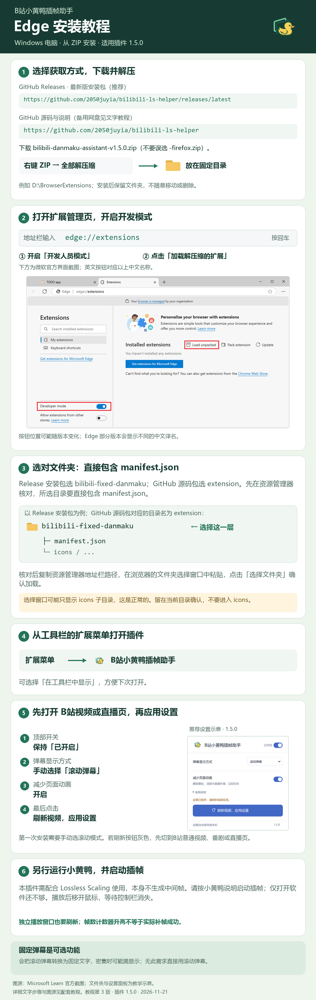
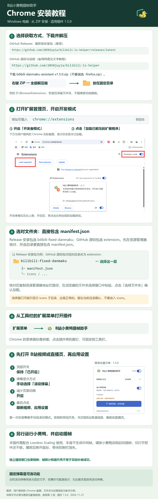
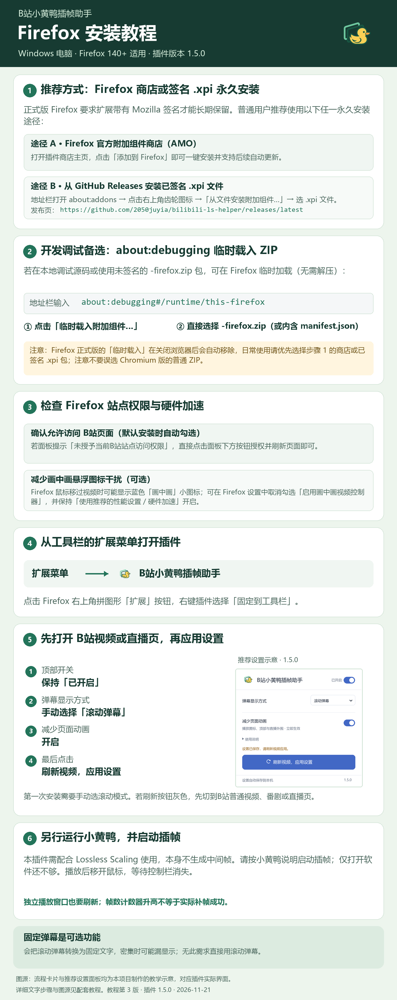

# B站小黄鸭插帧助手

给电脑浏览器使用的 Lossless Scaling（小黄鸭）配套插件，支持 **Edge、Chrome 与 Firefox（140+）** 下的B站视频、番剧与直播。处理可能干扰视频补帧的页面动画，让文字弹幕及直播图片表情跟随视频帧同步更新。

**插件本身不生成中间帧，需要配合 Lossless Scaling 使用。** 如果小黄鸭帧数显示上升，但视频运动画面仍不流畅，可以在相同视频片段中试用并比较实际效果。

## 1.5.0 更新要点

- **新增 Mozilla Firefox（140+）适配：** 支持 Firefox 正式版及 140 ESR，解决 Gecko 视频合成可见性、后台标签页挂起恢复及 `browser.*` Promise 通信差异，并提供符合 Mozilla 官方商店（AMO）规范的专用安装包。
- **新版番剧与电影播放指示图标屏蔽：** 打开“减少页面动画”后，旧版 `.playing-gif`、新版 `PlayingIcon_playIcon__` 共用组件及播放指示素材路径统一匹配，动态插入和随机哈希后缀变化也会自动应用。

## 下载与安装

- **最新版发布页：[GitHub Releases](https://github.com/2050juyia/bilibili-ls-helper/releases/latest)**（当前版本 **1.5.0**）：
  - **Edge / Chrome 安装包：** `bilibili-danmaku-assistant-v1.5.0.zip`（解压后加载 `bilibili-fixed-danmaku` 文件夹）。
  - **Firefox（140+）安装包：** 推荐通过 Firefox 官方商店一键安装，或在 `about:addons` 从文件安装已签名的 `.xpi` 包；开发调试可在 `about:debugging` 临时载入 `bilibili-danmaku-assistant-v1.5.0-firefox.zip`。
- **GitHub 源码与说明：[2050juyia/bilibili-ls-helper](https://github.com/2050juyia/bilibili-ls-helper)**。Edge / Chrome 点击 **Code → Download ZIP** 下载源码包时，解压后加载其中的 `extension` 文件夹。
- **备用旧入口：[夸克网盘](https://pan.quark.cn/s/4603da61b708)**。网盘可能仍为旧版，未确认同步更新；最新版本以 GitHub Releases 为准。

第一次安装可先看对应浏览器的图文教程：**[Edge 图文教程](docs/install-edge.zh-CN.md)** / **[Chrome 图文教程](docs/install-chrome.zh-CN.md)** / **[Firefox 图文教程](docs/install-firefox.zh-CN.md)**。

### Edge / Chrome 快速安装步骤

1. 将 `bilibili-danmaku-assistant-v1.5.0.zip` 解压到一个以后不会删除或移动的固定文件夹。
2. Chrome 打开 `chrome://extensions`；Edge 打开 `edge://extensions`。
3. 开启「开发者模式」，选择「加载已解压的扩展程序」。
4. 选择解压后**直接包含 `manifest.json`** 的文件夹：Release 安装包选 `bilibili-fixed-danmaku`；GitHub 源码包选 `extension`。
5. 刷新已经打开的B站视频或直播页，从右上角扩展菜单打开「B站小黄鸭插帧助手」。

```text
bilibili-fixed-danmaku/
├─ manifest.json
├─ popup.html
└─ icons/
```

### Firefox（140+）快速安装步骤

- **永久安装（正式版推荐）：** 在 Firefox 官方附加组件商店点击「添加到 Firefox」，或下载已签名 `.xpi` 文件后打开 `about:addons` → 右上角齿轮图标 →「从文件安装附加组件…」。
- **临时调试：** 打开 `about:debugging#/runtime/this-firefox` → 点击「临时载入附加组件…」→ 直接选择 `bilibili-danmaku-assistant-v1.5.0-firefox.zip`（无需解压；关闭 Firefox 后会自动移除）。

### Edge / Chrome / Firefox 安装图解

按使用的浏览器展开对应长图，也可打开 [离线切换预览页](docs/install.html) 查看。图源与复现方法见 [SOURCES.md](docs/assets/SOURCES.md)。

<details>
<summary>Microsoft Edge 安装图解（点击展开）</summary>



[查看／保存 Edge 原图](docs/assets/install-edge.png) · [Edge 完整文字教程与常见问题](docs/install-edge.zh-CN.md)

</details>

<details>
<summary>Google Chrome 安装图解（点击展开）</summary>



[查看／保存 Chrome 原图](docs/assets/install-chrome.png) · [Chrome 完整文字教程与常见问题](docs/install-chrome.zh-CN.md)

</details>

<details>
<summary>Mozilla Firefox 安装图解（点击展开）</summary>



[查看／保存 Firefox 原图](docs/assets/install-firefox.png) · [Firefox 完整文字教程与常见问题](docs/install-firefox.zh-CN.md)

</details>

### 浏览器兼容性

| 浏览器 | 验证情况 |
| --- | --- |
| Microsoft Edge | 已有实机与受控自动化验证记录（声明 Chromium 最低版本 111）。 |
| Google Chrome | 2026-10-19 用户基于 1.3.13 实测反馈正常使用（声明 Chromium 最低版本 111）。 |
| Mozilla Firefox | 1.5.0 已通过 Windows 版 Firefox 160.0.1 受控端到端自动化验收（声明最低桌面版本 140.0）。 |
| 360、QQ及其他浏览器 | 尚未完成验证，不将共享内核视为已确认兼容。 |

以上是已有环境的验证记录，不代表所有浏览器版本、设备和视频都已逐一实测。正式版 Firefox 安装持久扩展需经 Mozilla 签名（商店上架或已签名 `.xpi`），未签名 `-firefox.zip` 在正式版中仅支持 `about:debugging` 单次会话临时加载。遇到问题时请一并提供浏览器与系统版本信息。

## 推荐设置（与视频演示一致）

1. 点击扩展图标，打开总开关。
2. 「弹幕显示方式」选择 **滚动弹幕**。
3. 打开 **减少页面动画**。
4. 点击 **刷新视频，应用设置**。
5. 正常播放视频，移开鼠标并等待播放器控制栏消失，再用小黄鸭比较实际运动画面。

小黄鸭的帧数计数器上升不等于实际补帧成功。建议对照同一段运动画面，保持小黄鸭设置、播放速度和弹幕条件一致。

## 插件会做什么

| 功能 | 实际行为 |
| --- | --- |
| 滚动弹幕 | 在视频帧回调中合成视频与普通文字弹幕；直播还支持图片表情。滚动位置与动态表情跟随视频帧更新，暂停时停止持续更新。 |
| 固定弹幕 | 点播将普通滚动弹幕转换为原生固定文字；直播在本地显示层分配固定轨道。可选择上方、下方或上下分配，轨道不足时可能略过部分弹幕。 |
| 减少页面动画 | 屏蔽选集播放动态图标、停用顶部部分入口轮播；直播播放器全屏时隔离已识别的B站外围区域。保留播放器与控件，退出全屏或关闭设置后恢复外围页面；此开关独立于弹幕总开关。 |
| 自己发送的弹幕 | 合成时保留原生蓝色边框、透明度和位置。发送到B站服务器的内容与类型不由插件改写。 |
| 直播原画切流保护 | 助手启用时让手动画质切换重新取得所选画质及备用线路，减少自动换线误用旧画质的情况；代价是切画质时可能短暂重新缓冲。 |

直播表情支持静态图片，以及浏览器解码能力和资源限额允许的 GIF、APNG、WebP 动图。图片加载完成只更新缓存，等下一视频帧呈现；读取或解码失败时显示占位，动态图片过大或解码能力不足时使用静帧。

针对直播视频处理帧数与呈现回调持续不一致的情况，助手会在现有视频回调内进行一次短暂合成状态恢复，经过两个成功视频帧后还原临时属性。同一视频实例最多尝试一次，重建画布、切模式或开关助手不重置额度。触发条件不是故障诊断，正常高帧率源与真实负载过高也可能满足；不能保证恢复，也不会无限重试。

推荐选择「滚动弹幕」。**只有想把滚动弹幕改成固定文字时，才选择「固定弹幕」**，并在B站允许显示对应位置的固定弹幕；密集场景下，原生固定弹幕可能省略部分内容（漏显示）。没有这个需求，直接使用滚动模式。滚动模式也会保留原有固定弹幕。

首次安装请手动检查并选择上述模式，不以初始选项代替实际设置。

## 更新后要刷新实际播放窗口

替换扩展文件后，在扩展管理页点击「重新加载」，再对**实际正在播放的窗口**完整刷新一次。如果正在使用独立播放器窗口，也要刷新该窗口；必要时关闭旧窗口，从刷新后的视频页重新打开。

只切换选集，或只确认扩展管理页的版本号，并不能证明旧播放窗口已加载新脚本。

## 支持范围与限制

- 适用于电脑浏览器中的B站普通视频、番剧播放页及数字房间号直播页（含 `/blanc/数字房间号`）；不适用于手机App或B站电脑客户端。
- 点播滚动模式主要合成普通文字；直播另支持图片表情。渐变、其他特效及弹幕悬停、点赞等交互暂不支持。直播被接管的弹幕层内其他互动特效会暂时不显示；礼物等独立动画不在同步保证范围内，仍可能影响捕获。
- 原生视频进度、暂停、音量和全屏控制继续使用。视频与文字经过画布重绘，色彩、字形及HDR等情况需要实测。
- 小黄鸭会对合成后的完整画面生成中间帧，本插件不能保证消除弹幕文字的模糊、重影或变形。
- 这是针对特定页面干扰的处理，不保证解决所有设备、浏览器、视频及小黄鸭故障。其他动态网页元素和播放器变化仍可能影响捕获。
- 暂态合成故障会尝试有限次数自动恢复；持续失败时恢复原生画面维持播放。
- 与其他改写弹幕或播放器的扩展同时使用时，可能出现冲突。B站更新页面或私有接口后，也可能需要更新本插件。

## 遇到问题

先确认已刷新实际播放窗口，再暂时停用其他弹幕或播放器增强插件进行对照。如果问题仍在，可到 [GitHub Issues](https://github.com/2050juyia/bilibili-ls-helper/issues) 留下：

- 浏览器及版本、插件版本。
- Lossless Scaling 版本、捕获方式、固定或自适应模式及倍数。
- 视频页面和能复现的时间点、视频源帧率、弹幕显示方式。
- 实际现象：画面未变流畅、弹幕异常、画面停住，或计数器异常；以及可复现步骤。

不要上传Cookie、账号凭据或完整浏览器配置。

## 权限与数据

扩展只申请 `storage` 和 `activeTab`。设置保存在浏览器扩展本地存储中；`activeTab` 用于用户操作扩展时读取当前页状态和刷新当前视频。

扩展不读取Cookie，不上传浏览记录或弹幕，不修改发送到B站服务器的弹幕。最近少量故障分类与恢复结果仅保存在当前页面会话中，不记录弹幕内容、完整URL或错误堆栈。

## 开发与测试

插件运行不需要构建工具。开发检查需要 Node.js 22 或更高版本：

```sh
npm test
npm run check
```

打包需要 Python 3.9+ 和 Git：

```sh
python scripts/package.py
```

打包脚本读取**已提交的 HEAD**，同时生成面向 Edge / Chrome 的 `bilibili-danmaku-assistant-v1.5.0.zip` 与面向 Firefox / AMO 的根目录结构包 `bilibili-danmaku-assistant-v1.5.0-firefox.zip`，并写入 `release-manifest.json` 与 `SHA256SUMS.txt`。本地调试 Firefox 可运行 `npm run build:firefox-dev` 生成解包目录，或运行 `node scripts/firefox-ui-check.cjs` 执行本机 Firefox Marionette 端到端检查。AMO 上架流程与文案见 [docs/amo-submission-guide.zh-CN.md](docs/amo-submission-guide.zh-CN.md)。大型测试产物、浏览器配置和日志留在忽略的工作目录，不加入仓库。

本公开源码包含无需第三方依赖的 Node.js 测试。早期依赖特定浏览器配置或旧开发历史的辅助脚本没有随包发布；`scripts/passive-frame-audit.js` 是供开发者使用的被动检查工具，不由扩展加载。受控检查的边界见 `TEST-REPORT.md`，它们不等于小黄鸭在所有设备上的实测结果。

1.4.5修复了离场慢表情占用加载名额、同一播放器替换弹幕容器后没有重绑，以及快速修改设置后关闭面板丢失后项的问题。发布范围及测试摘要见 [1.4.5发布说明](RELEASE_NOTES_v1.4.5.md) 和 [更新摘要](CHANGELOG.md)。

安装教程的图片可用 `python scripts/render-install-guides.py` 重新生成，额外依赖仅为Pillow，详见 `scripts/requirements-docs.txt` 和 [图源与复现说明](docs/assets/SOURCES.md)。这不是插件运行或普通安装所需的依赖。

## 许可与名称

本项目由 2050juyia 维护，原创源代码采用 MIT License，见 `LICENSE`。第三方商标、平台内容和第三方素材不随本项目的源码许可授权；见 `THIRD_PARTY_NOTICES.md`。

本项目是第三方辅助工具，与 bilibili、Lossless Scaling 官方无隶属关系。更新摘要见 `CHANGELOG.md`。
