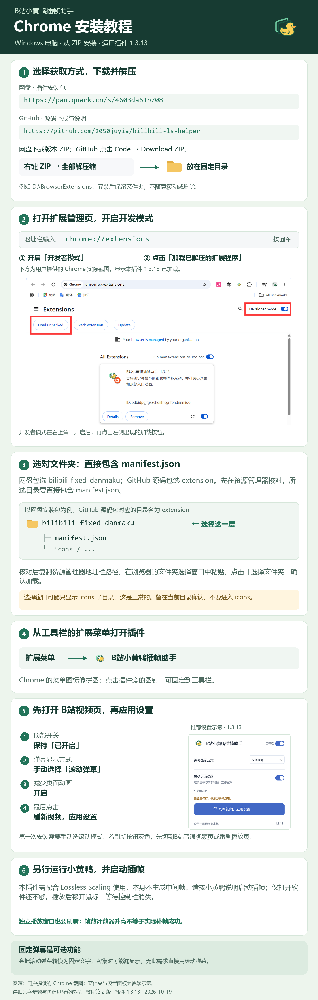

# Chrome：从ZIP安装B站小黄鸭插帧助手

适用于Windows电脑上的Google Chrome。本插件需要配合Lossless Scaling（小黄鸭）使用，本身不生成中间帧。



Chrome浏览器部分使用用户提供的真实截图，截图中的插件版本为1.3.13；文件夹和推荐设置面板为教学示意，并非本轮重新安装的完整过程截图。浏览器版本不同，按钮文字和位置可能略有变化。[图源与复现说明](assets/SOURCES.md)

## 1. 下载并解压

两种获取方式任选其一：

- **夸克安装包：**打开[夸克网盘下载页](https://pan.quark.cn/s/4603da61b708)，下载 `bilibili-danmaku-assistant-v1.3.13.zip`。
- **GitHub源码包：**打开[2050juyia/bilibili-ls-helper](https://github.com/2050juyia/bilibili-ls-helper)，点击 **Code → Download ZIP**。解压后需加载里面的 `extension` 文件夹；不要选择整个源码目录。GitHub目前没有已发布的Release安装包。

在Windows文件资源管理器中右键点击ZIP，选择「全部解压缩／全部解压」。解压到以后不会随手清理的固定目录，例如 `D:\BrowserExtensions`。安装后仍要保留解压出的文件夹；不能只留下ZIP，也不要随意移动文件夹。

## 2. 在Chrome加载文件夹

1. 把 `chrome://extensions` 复制到Chrome地址栏，按回车。
2. 开启右上角的「开发者模式」。
3. 点击页面出现的「加载已解压的扩展程序」。
4. 根据下载来源选择目录：**夸克安装包选 `bilibili-fixed-danmaku`；GitHub源码包选解压目录里的 `extension`**。确认选中的文件夹直接包含 `manifest.json`。

```text
夸克包：bilibili-fixed-danmaku/       ← 选择这一层
GitHub源码包：源码解压目录/extension/  ← 选择这一层

所选目录内应直接包含：manifest.json、popup.html、icons/ 等
```

不是选择ZIP，也不是选择外层下载目录。若解压工具又套了一层同名文件夹，请继续往里找，直到能直接看到 `manifest.json`。

Windows若隐藏扩展名，文件可能显示为 `manifest`；这里只用它核对目录，不需要双击或修改这个文件。

建议先在资源管理器核对目录并复制地址栏路径，再到浏览器的文件夹选择窗口粘贴路径并确认。**文件夹选择窗口可能只显示 `icons` 子目录，不显示 `manifest.json` 等文件，这是正常的；留在当前插件目录确认，不要再进入 `icons`。**

## 3. 找到插件并应用设置

Chrome出现「B站小黄鸭插帧助手」卡片后，先打开一个B站视频页。点击浏览器工具栏的拼图形「扩展程序」菜单，找到这个名称并打开；可点击旁边的图钉，将插件固定在工具栏。

在插件面板中依次操作：

1. 打开总开关。
2. 「弹幕显示方式」选择**滚动弹幕**。
3. 开启**减少页面动画**。
4. 点击**刷新视频，应用设置**，等待视频页重新加载。

然后另行运行Lossless Scaling，并按其说明启动插帧；仅打开软件不等于已开始插帧。播放视频、移开鼠标并等待控制栏消失，再观察实际运动画面。计数器升高不代表补帧已经成功。

「固定弹幕」是可选显示方式，会把普通滚动弹幕改成固定文字；密集时可能有部分漏显示。没有这个需求，直接使用滚动弹幕。

## 常见问题

**提示清单文件缺失或无法加载？** 多数是选错目录。夸克包选 `bilibili-fixed-danmaku`，GitHub的 **Code → Download ZIP** 源码包选其中的 `extension`；两者都要选直接包含 `manifest.json` 的那一层。

**装好却找不到图标？** 点击Chrome工具栏的「扩展程序」菜单，找到「B站小黄鸭插帧助手」并点图钉；没固定图标不代表没安装。

**改完设置或更新后没变化？** 刷新实际播放视频的窗口。更新文件后还需先在扩展管理页点击「重新加载」；独立播放器窗口也要完整刷新，只切选集不够。

**仍然不流畅怎么办？** 确认小黄鸭已运行，暂时关闭其他弹幕或播放器增强扩展进行对照。插件不处理网络缓冲，也不保证适用于所有设备和故障；可带浏览器、插件与小黄鸭版本及复现步骤到[Issues](https://github.com/2050juyia/bilibili-ls-helper/issues)反馈。
