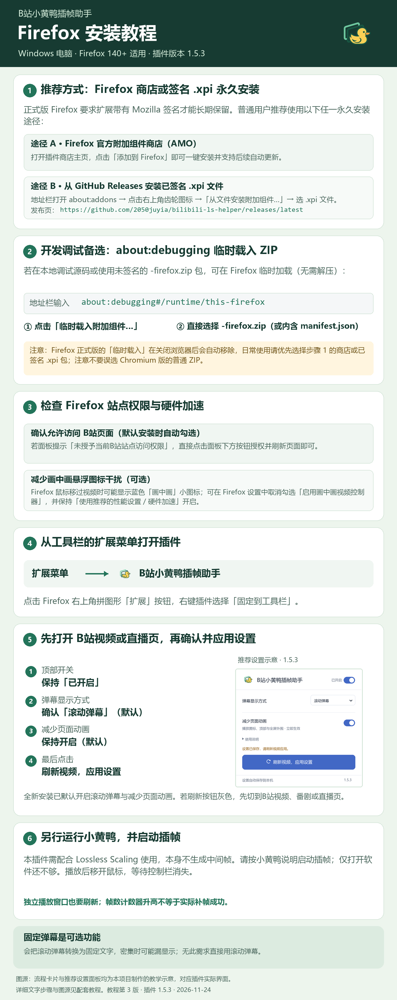

# Firefox：安装与配置B站小黄鸭插帧助手

适用于Windows电脑上的 **Mozilla Firefox 140 及更新版本**（含 Firefox 140 ESR 与正式版）。本插件需要配合 Lossless Scaling（小黄鸭）使用，本身不生成中间帧。

当前版本为 **1.5.3**，支持B站普通视频、番剧与数字房间号直播（全新安装默认启用「滚动弹幕」与「减少页面动画」）。

流程卡片与推荐设置面板为教学示意，对应插件 1.5.3 实际界面。不同 Firefox 版本菜单译名可能略有差异。[图源与复现说明](assets/SOURCES.md)

## 1. 选择安装方式

与 Edge / Chrome 不同，**标准正式版 Firefox 要求扩展带有 Mozilla 官方数字签名才能长期保留**。请根据用途选择以下方式：

### 方式 A（推荐，正式版永久安装）：Firefox 官方附加组件商店或已签名 `.xpi`

- **Firefox 官方商店（AMO）：** 在商店页面点击 **「添加到 Firefox」** 即可一键安装，并支持后续自动更新（首次上架审核通过后会在仓库首页补充商店直达链接）。
- **从文件安装已签名 `.xpi`：**
  1. 从 [GitHub Releases](https://github.com/2050juyia/bilibili-ls-helper/releases/latest) 下载经过 Mozilla 签名的 `.xpi` 安装包。
  2. 在 Firefox 地址栏输入 `about:addons` 并按回车，进入左侧「扩展」页。
  3. 点击页面右上角的**齿轮图标**，选择 **「从文件安装附加组件…」**。
  4. 选择下载好的 `.xpi` 文件，在弹出的权限确认框中点击「添加」。

### 方式 B（开发调试／上架审核前临时体验）：`about:debugging` 临时载入

如果正在本地测试源码，或需要在商店签名包就绪前立即试用，可直接载入 Firefox 专用压缩包 `bilibili-danmaku-assistant-v1.5.3-firefox.zip`（**无需解压，注意不要误选 Chromium 版的普通 ZIP**）：

1. 在 Firefox 地址栏输入 `about:debugging#/runtime/this-firefox` 并按回车。
2. 点击 **「临时载入附加组件…」**。
3. 直接选择 `bilibili-danmaku-assistant-v1.5.3-firefox.zip`（或使用 `npm run build:firefox-dev` 生成目录下的 `manifest.json`）。

> **提示：** 正式版 Firefox 的「临时载入」仅在当前浏览器会话内有效，**关闭 Firefox 后会自动移除**。日常长期使用请采用方式 A 的商店安装或已签名 `.xpi` 包。

## 2. 检查站点权限与 Firefox 播放设置

1. **站点访问权限：** Firefox 安装 Manifest V3 扩展时会提示授权访问 `www.bilibili.com` 与 `live.bilibili.com`。若后续在扩展管理页手动关闭了站点权限，打开插件面板会看到「未授予当前B站站点访问权限」提示，直接点击面板底部 **「授权当前B站页面并刷新」** 即可恢复。
2. **保持硬件加速开启：** 在 Firefox「设置 → 常规 → 性能」中，保持勾选「使用推荐的性能设置」（或「可用时使用硬件加速」），保证视频解码与画布合成帧率稳定。
3. **可选隐藏画中画悬浮按钮：** Firefox 鼠标移过视频画面时可能浮现蓝色的原生「画中画」开关图标；如希望减少画面外围浮动元素，可在 Firefox「设置 → 常规 → 浏览」中取消勾选「启用画中画视频控制器」。

## 3. 找到插件并应用推荐设置

先打开一个B站视频、番剧或直播间页面。点击 Firefox 工具栏右上角的拼图形 **「扩展」** 按钮，找到「B站小黄鸭插帧助手」；可右键点击它并选择 **「固定到工具栏」**。

在插件面板中确认推荐设置（1.5.3 全新安装已默认开启）：

1. 打开顶部总开关（显示「已开启」）。
2. 「弹幕显示方式」确认选择 **滚动弹幕**。
3. 开启 **减少页面动画**。
4. 点击 **刷新视频，应用设置**，等待页面重新加载。

随后运行 Lossless Scaling（小黄鸭）并启动插帧；播放视频后移开鼠标，等待播放器控制栏自动隐藏，再对照同一运动片段观察实际画面效果。帧数计数器升高不等于实际补帧成功。

## 常见问题

**提示“此附加组件似乎已损坏”或“找不到 manifest.json”？**
多数是因为把面向 Edge / Chrome 的普通 `bilibili-danmaku-assistant-v1.5.3.zip`（内含一层子目录）当成 Firefox 包直接载入了。Firefox 临时载入必须选文件名带 `-firefox.zip` 的专用包，永久安装请选已签名的 `.xpi` 包或通过官方商店安装。

**切换后台标签页后再切回来会影响同步吗？**
Firefox 默认会在标签页切到后台数秒后挂起视频解码、仅保留声音播放。1.5.0 已针对后台标签页挂起做专门保护，不会在后台误判停滞或消耗恢复次数，切回前台后会自动随下一视频帧继续同步。

**改完设置没有生效？**
确认已点击「刷新视频，应用设置」（只有「减少页面动画」为立即生效，弹幕显示模式与总开关均需刷新实际播放窗口后完整应用）。完整限制与反馈方式见 [README](../README.md#支持范围与限制)。
